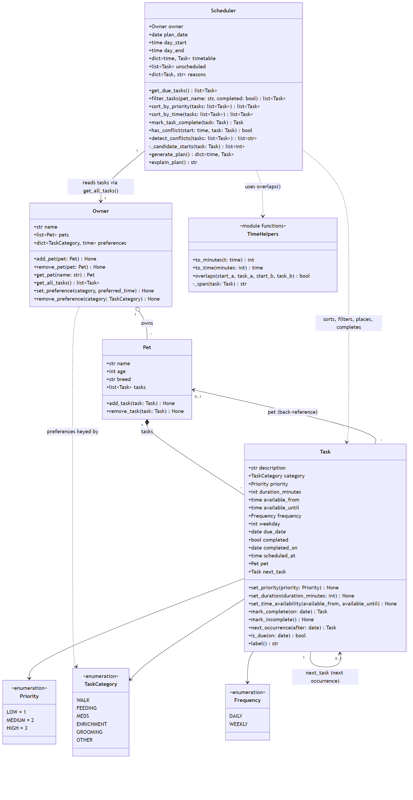

# PawPal+ (Module 2 Project)

You are building **PawPal+**, a Streamlit app that helps a pet owner plan care tasks for their pet.

## Scenario

A busy pet owner needs help staying consistent with pet care. They want an assistant that can:

- Track pet care tasks (walks, feeding, meds, enrichment, grooming, etc.)
- Consider constraints (time available, priority, owner preferences)
- Produce a daily plan and explain why it chose that plan

Your job is to design the system first (UML), then implement the logic in Python, then connect it to the Streamlit UI.

## What you will build

Your final app should:

- Let a user enter basic owner + pet info
- Let a user add/edit tasks (duration + priority at minimum)
- Generate a daily schedule/plan based on constraints and priorities
- Display the plan clearly (and ideally explain the reasoning)
- Include tests for the most important scheduling behaviors

## Getting started

### Setup

```bash
python -m venv .venv
source .venv/bin/activate  # Windows: .venv\Scripts\activate
pip install -r requirements.txt
```

### Suggested workflow

1. Read the scenario carefully and identify requirements and edge cases.
2. Draft a UML diagram (classes, attributes, methods, relationships).
3. Convert UML into Python class stubs (no logic yet).
4. Implement scheduling logic in small increments.
5. Add tests to verify key behaviors.
6. Connect your logic to the Streamlit UI in `app.py`.
7. Refine UML so it matches what you actually built.

## 🖥️ Sample Output

Paste a sample of your app's CLI or Streamlit output here so a reader can see what a generated plan looks like:

```
============================================================
Today's Schedule
============================================================
Plan for Jordan on Tuesday 20 October 2026:
  07:30-08:00  Morning walk for Biscuit [HIGH] - at your preferred time
  08:00-08:10  Breakfast for Biscuit [HIGH] - earliest free slot in its window
  12:00-12:05  Thyroid meds for Mochi [HIGH] - earliest free slot in its window
  17:00-17:20  Laser pointer play for Mochi [MEDIUM] - earliest free slot in its window
```

## Testing PawPal+

Run the full test suite from the project root (with the virtual environment activated):

```bash
python -m pytest
```

The tests in `tests/test_pawpal.py` cover:

- **Sorting:** `sort_by_time` returns tasks in chronological order, using the booked time once a task is scheduled. `sort_by_priority` puts the highest priority first and breaks ties by the tighter time window.
- **Recurring tasks:** completing a daily task creates a copy due the next day (including from Dec 31 to Jan 1). Completing a weekly task, even late, creates a copy due on its next weekday. Completing a task twice or undoing a completion leaves no extra copies, even when later copies were also completed.
- **Conflict detection:** `detect_conflicts` flags tasks that start at the same time or overlap, for the same pet or different pets, and reports every overlapping pair. Back-to-back tasks and unscheduled tasks are not flagged.
- **Scheduling boundaries:** a task that exactly fills its window gets scheduled, a task longer than its window is listed as unscheduled, a generated plan has no conflicts, and generating a plan twice gives the same result.

Sample test output:

```
========================================================= test session starts ==========================================================
platform win32 -- Python 3.14.8, pytest-9.1.1, pluggy-1.7.0
rootdir: C:\Users\there\OneDrive\Documents\Visual Studio Code\ai110-module2show-pawpal-starter
configfile: pytest.ini
testpaths: tests
plugins: anyio-4.15.1
collected 21 items                                                                                                                      

tests\test_pawpal.py ..............x......                                                                                        [100%]

==================================================== 20 passed, 1 xfailed in 0.08s =====================================================
(.venv) PS C:\Users\there\OneDrive\Documents\Visual Studio Code\ai110-module2show-pawpal-starter> python -m pytest
========================================================= test session starts ==========================================================
platform win32 -- Python 3.14.8, pytest-9.1.1, pluggy-1.7.0
rootdir: C:\Users\there\OneDrive\Documents\Visual Studio Code\ai110-module2show-pawpal-starter
configfile: pytest.ini
testpaths: tests
plugins: anyio-4.15.1
collected 21 items                                                                                                                      

tests\test_pawpal.py .....................                                                                                        [100%]

========================================================== 21 passed in 0.02s ==========================================================
```

My confidence level is a 5 in the system's reliability based on test results.

## Short Implementation Summary

PawPal+ keeps track of care tasks for all of an owner's pets and builds a daily plan around priorities, time windows, and the owner's preferred times. The logic lives in `pawpal_system.py`; `main.py` runs a demo from the terminal.

**Classes**

- **`Task`**: one care activity. Stores a description, category (walk, feeding, meds, …), priority, duration, the time window it can happen in, how often it repeats (daily or weekly), and whether it's done. `is_due(date)` says whether it needs doing on a given day.
- **`Pet`**: a pet's details plus its own list of tasks. `add_task()` also links the task back to the pet.
- **`Owner`**: holds the pets and the owner's preferred times for each kind of task, such as walks at 7:30. `get_all_tasks()` returns every pet's tasks in one list.
- **`Scheduler`**: the planner. It is given an `Owner` and reads tasks only through `owner.get_all_tasks()`, so it plans across all pets at once.

**How a plan is made** (`Scheduler.generate_plan()`)

1. Collect every task due on the plan date. Completed tasks, tasks whose next occurrence isn't due yet, and weekly tasks on other days are left out.
2. Sort by priority, highest first. If two tasks tie, the one with the shorter time window goes first.
3. Give each task the earliest start time inside its window that doesn't overlap a task already placed. If the owner has a preferred time for that category, try the times closest to it first.
4. Put any task that can't fit into `unscheduled`.

`explain_plan()` prints the timetable along with the reason for each placement and each skipped task.

**Class diagram:** [`diagrams/uml_final.mmd`](diagrams/uml_final.mmd) (the Phase 1 design is in [`diagrams/uml_draft.mmd`](diagrams/uml_draft.mmd)).



## ✨ Features

- **Multi-pet planning.** One plan covers every pet. The `Scheduler` reads all tasks through `Owner.get_all_tasks()`, so tasks for different pets never get double-booked.
- **Priority-first scheduling.** `generate_plan()` places HIGH tasks before MEDIUM and LOW. When two tasks have the same priority, the one with the shorter time window goes first, because it has fewer places it can fit.
- **Time-window placement.** Each task is only placed inside its own window (for example, meds between 12:00 and 12:30) and inside the owner's day (`day_start` to `day_end`). Start times are tried every 5 minutes.
- **Owner preferences.** If the owner prefers a time for a kind of task (for example, walks at 7:30), the scheduler tries the start times closest to it first. If that time is taken, it uses the closest free one.
- **Sorting by time.** `sort_by_time()` lists tasks earliest first, by booked time once a task is scheduled, or by window start before that.
- **Sorting by priority.** `sort_by_priority()` lists the most important tasks first. `generate_plan()` uses the same order to decide which task gets placed first.
- **Filtering.** `filter_tasks()` narrows the list to one pet, to done or not-done tasks, or both. `get_due_tasks()` keeps only what's due on the plan date.
- **Daily and weekly recurrence.** Marking a task complete creates its next occurrence: tomorrow for daily tasks, or the next matching weekday for weekly ones, even if it was completed late. Undoing a completion removes the copies it created.
- **Conflict warnings.** `generate_plan()` never double-books. `detect_conflicts()` still checks every pair of timed tasks and returns a readable warning for each overlap, saying whether it's the same pet or different pets. Back-to-back tasks are not conflicts.
- **Unscheduled tasks are reported, not dropped.** A task that can't fit goes into `unscheduled` with the reason, for example "no free 20-min slot between 09:00 and 09:20".
- **Plan explanations.** Every placed task records why it landed there: "at your preferred time", "closest free slot to your preferred 08:30", or "earliest free slot in its window".
- **Input validation.** Tasks with a zero duration, a window that ends before it starts, or a weekly repeat with no weekday are rejected with a clear error, and so is a second pet with the same name.


## 📐 Smarter Scheduling

| Feature | Method(s) | Notes |
|---------|-----------|-------|
| Sort by priority | `Scheduler.sort_by_priority()` | Highest priority first; ties go to the task with the shorter time window. Used by `generate_plan()`. |
| Sort by time | `Scheduler.sort_by_time()` | Earliest first, by scheduled time, or by window start if not scheduled yet. |
| Filtering | `Scheduler.filter_tasks()`, `Scheduler.get_due_tasks()` | Filter by pet name, completion status, or both; due tasks only. |
| Recurring tasks | `Task.mark_complete()`, `Task.next_occurrence()`, `Task.is_due()` | Completing a task creates the next occurrence. |
| Conflict detection | `Scheduler.detect_conflicts()`, `Scheduler.has_conflict()`, `overlaps()` | Warns about overlapping tasks instead of crashing. |

**Sorting.** `sort_by_priority()` decides the order in which `generate_plan()` places tasks. `sort_by_time()` is for showing tasks in time order. Its `sorted()` key is a lambda that turns each task's time into an `"HH:MM"` string. Zero-padded strings sort the same way as the times they stand for (`"07:30" < "12:00"`).

**Filtering.** `filter_tasks(pet_name=None, completed=None)` narrows the owner's tasks to one pet, to done or not-done tasks, or both. A filter left as `None` is skipped. `get_due_tasks()` keeps only the tasks due on the plan date, and those are the only tasks the scheduler plans.

**Recurring tasks.** When a daily or weekly task is marked complete (`Task.mark_complete()` or `Scheduler.mark_task_complete()`), `next_occurrence()` makes a fresh copy. The copy's `due_date` is the next day for daily tasks, or the same weekday next week for weekly ones, and it is added to the same pet. `is_due()` treats a completed task as finished for good and doesn't let the new copy show up before its `due_date`, so a day never gets two copies of the same task. Completing a task twice does nothing the second time. `mark_incomplete()` removes the copy that was created.

**Conflict detection.** `generate_plan()` uses `has_conflict()` so it never schedules two overlapping tasks. A time can still be set by hand, though, so `detect_conflicts()` checks every pair of timed tasks, for the same pet or different pets. It returns a list of warnings such as `Warning: Morning walk for Biscuit (07:30-08:00) overlaps Thyroid meds for Mochi (07:30-07:35) [different pets]`. An empty list means no conflicts, and it never raises an error. Both methods use the same `overlaps()` check: tasks that share at least one minute conflict, and back-to-back tasks (one ends at 8:00, the next starts at 8:00) don't.

## 📸 Demo Walkthrough

Start the app with `streamlit run app.py` (with the virtual environment activated).

### Main UI features

| Area | What you can do |
|------|-----------------|
| **Sidebar: Plan settings** | Set the owner's name, the date to plan, and when the day starts and ends. Save a preferred time for any task category (for example, walks around 07:30) and remove it again. |
| **Pets** | Add a pet with name, age, and breed. A table shows each pet with how many tasks are due on the plan date and how many are done. A second pet with the same name is rejected with an error. |
| **Tasks** | Add a task for any pet: description, category, priority, duration, time window, and whether it repeats daily or weekly. The task table can be filtered by pet and by status (to do or done) and sorted by time or priority. Each row shows a status: 📅 Due, ⏳ not due yet, or ✅ Done. |
| **Mark complete / Undo** | Pick a task and mark it complete. The app confirms when the next occurrence is due. Undo puts a completed task back and removes that next occurrence. |
| **Schedule** | Click **Generate schedule** to see summary numbers (tasks scheduled, busy minutes, tasks that couldn't fit, conflicts), a time-ordered timetable with a "Why here" column, a green confirmation when nothing overlaps, a yellow warning for each task that couldn't fit, and the full plain-text explanation. The schedule refreshes automatically as you add or complete tasks. |

### Example workflow

1. In the sidebar, keep the owner as **Jordan**, set the day to start at **07:00**, and save a preference: **Walk** around **07:30**.
2. Under **Pets**, add **Biscuit** (3, Golden Retriever) and **Mochi** (5, Tabby Cat).
3. Under **Tasks**, add:
   - Biscuit: *Morning walk*, Walk, High, 30 min, 07:00-09:00
   - Biscuit: *Breakfast*, Feeding, High, 10 min, 08:00-08:30
   - Mochi: *Thyroid meds*, Meds, High, 5 min, 12:00-12:30
   - Mochi: *Laser pointer play*, Enrichment, Medium, 20 min, 17:00-19:00
4. Set **Sort by** to *Time* to see the tasks in the order they can start, or filter **Show pet** to *Mochi* to see only Mochi's tasks.
5. Click **Generate schedule**. The walk lands at 07:30 ("at your preferred time"), breakfast at 08:00, meds at 12:00, and play at 17:00, with "No overlapping tasks" confirmed.
6. Mark *Breakfast for Biscuit* complete. The app says the next breakfast is due tomorrow, the task's status changes to ✅ Done, and the schedule drops it for today.

### Key Scheduler behaviors shown

- **Sorting:** the task table uses `sort_by_time()` or `sort_by_priority()`, and the timetable is always in time order.
- **Filtering:** the pet and status filters call `filter_tasks()`, and only tasks where `is_due()` is true for the plan date are scheduled.
- **Preferences:** a task with a preferred time is placed at or as close to it as possible.
- **Recurrence:** completing a task creates its next occurrence, and undo removes it.
- **Conflict warnings:** the schedule runs `detect_conflicts()` and shows a warning for any overlap. The CLI demo below moves tasks onto the same time on purpose to show the warnings.
- **Couldn't-fit warnings:** tasks with no free slot are listed with the reason, never dropped silently.

### Sample CLI output (`python main.py`)

```
--- Tasks as added ---
  from 18:00  Brushing for Biscuit
  from 08:00  Breakfast for Biscuit
  from 07:00  Morning walk for Biscuit
  from 17:00  Laser pointer play for Mochi
  from 12:00  Thyroid meds for Mochi


--- Sorted by time (before scheduling) ---
  from 07:00  Morning walk for Biscuit
  from 08:00  Breakfast for Biscuit
  from 12:00  Thyroid meds for Mochi
  from 17:00  Laser pointer play for Mochi
  from 18:00  Brushing for Biscuit

Completed Breakfast for Biscuit; next one is due Thursday 22 October.

--- Sorted by time (after scheduling) ---
       07:30  Morning walk for Biscuit
       08:00  Breakfast for Biscuit [done]
  from 08:00  Breakfast for Biscuit
       12:00  Thyroid meds for Mochi
       17:00  Laser pointer play for Mochi
  from 18:00  Brushing for Biscuit


--- Only Mochi's tasks ---
       17:00  Laser pointer play for Mochi
       12:00  Thyroid meds for Mochi


--- Completed tasks ---
       08:00  Breakfast for Biscuit [done]


--- Biscuit's incomplete tasks, by time ---
       07:30  Morning walk for Biscuit
  from 08:00  Breakfast for Biscuit
  from 18:00  Brushing for Biscuit

============================================================
Today's Schedule
============================================================
Plan for Jordan on Wednesday 21 October 2026:
  07:30-08:00  Morning walk for Biscuit [HIGH] - at your preferred time
  08:00-08:10  Breakfast for Biscuit [HIGH] - earliest free slot in its window
  12:00-12:05  Thyroid meds for Mochi [HIGH] - earliest free slot in its window
  17:00-17:20  Laser pointer play for Mochi [MEDIUM] - earliest free slot in its window

--- Conflict check on the generated plan ---
  No conflicts.

--- Conflict check after moving Mochi's tasks to 07:30 ---
  Warning: Morning walk for Biscuit (07:30-08:00) overlaps Laser pointer play for Mochi (07:30-07:50) [different pets]
  Warning: Morning walk for Biscuit (07:30-08:00) overlaps Thyroid meds for Mochi (07:30-07:35) [different pets]
  Warning: Laser pointer play for Mochi (07:30-07:50) overlaps Thyroid meds for Mochi (07:30-07:35) [same pet]
```

Brushing is a weekly task due on Sundays, so it isn't in Wednesday's schedule.

**Screenshot or video** *(optional)*: <!-- Insert a screenshot or link to a demo video here -->
